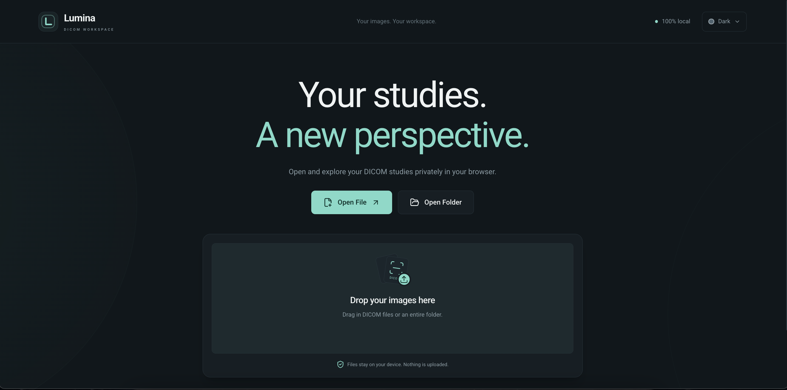
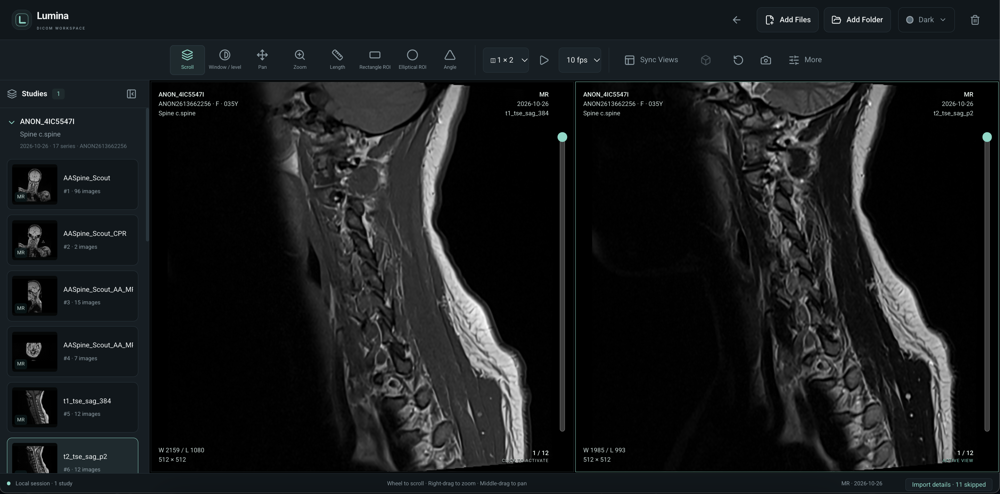
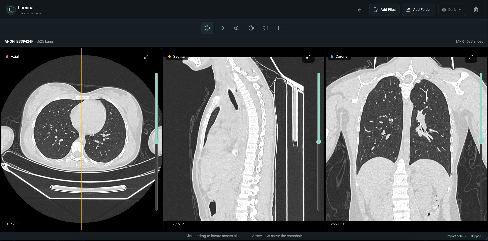

# Lumina

Lumina is a browser-based DICOM workspace for privately importing, organizing, viewing, comparing, and measuring medical images. Files are processed locally in the browser; the app has no accounts, uploads, analytics, or application backend.

## Technology

    

## Screenshots



| Two-viewport comparison | Multiplanar reconstruction |
| :---: | :---: |
|  |  |

The screenshots show anonymized demonstration studies.

## Features

- Import individual DICOM files, multiple files, or nested folders by picker or drag and drop.
- Organize images automatically by study and series, including supported multiframe images.
- Work with 1×1, 1×2, 2×1, and 2×2 viewport layouts.
- Scroll stacks, play cine, adjust window/level, pan, zoom, rotate, flip, invert, and apply CT presets.
- Measure length, angle, Cobb angle, bidirectional diameter, rectangle and elliptical ROI, freehand ROI, and spline ROI.
- Add arrow annotations, inspect pixels, magnify regions, and derive regional window/level settings.
- Synchronize compatible viewports and display reference lines across matching image geometry.
- Reconstruct eligible series as linked axial, sagittal, and coronal MPR views with crosshair navigation.
- Bookmark key images and return to an exact series and frame during the current session.
- Export measurement summaries as CSV or JSON and download viewport screenshots as PNG.
- Switch between Dark, Light, Blue, and Green themes.

## Using the workspace

1. Open DICOM files or a folder from the home page. Extensionless DICOM files are supported.
2. Choose a viewport layout and click a viewport to make it active.
3. Click a series thumbnail to load it into the active viewport, or drag a thumbnail onto a viewport on desktop.
4. Use the toolbar for navigation, presentation, measurements, comparison, screenshots, and MPR.
5. Open the Measurements panel to review, rename, hide, revisit, delete, or export annotations for the active series.

Additional imports merge with the current session and skip repeated SOP Instance UIDs. Returning to the home page keeps the imported catalog available, while refreshing or closing the tab clears the session. **Clear Session** releases imported files, measurements, bookmarks, thumbnails, MPR volumes, and rendering caches.

### Controls

| Action | Control |
| --- | --- |
| Scroll images | Mouse wheel, vertical slice slider, or Scroll (`S`) |
| Window / level | Window tool (`W`) and drag |
| Pan | Pan (`P`) or middle-button drag |
| Zoom | Zoom (`Z`) or right-button drag |
| Length measurement | Length (`L`) |
| Arrow annotation | Arrow (`A`) |
| Bidirectional measurement | Bidirectional (`B`) |
| Pixel probe | Pixel probe (`I`) |
| Magnifier | Magnifier (`M`), then hold and drag |
| Reset presentation | Reset (`R`) |
| Delete selected measurement | Delete or Backspace |
| Cine | Play/Pause or Space; choose 5–30 fps |
| Screenshot | Camera, optionally crop, then download PNG |

Touch devices use one finger for the selected tool and two fingers to pan. Keyboard shortcuts pause while a dialog or form control has focus.

## Supported imports

Lumina accepts DICOM Part 10 images using common uncompressed, RLE, JPEG, JPEG-LS, JPEG 2000, and HTJ2K transfer syntaxes supported by the bundled Cornerstone loader. It handles single-frame images and supported multiframe stacks. DICOMDIR acts as an index, so import its containing folder to load the referenced image files.

MPR is available for compatible single-frame grayscale series with consistent spatial geometry and at least two slices. Unsupported objects or decoding failures are reported instead of being silently added. All image processing stays in the browser, so the practical size of a session depends on the device's available memory and graphics support.

## Development

Use Node.js 20.19 or a supported newer LTS release.

```sh
npm ci
npm run dev
```

Open the local URL printed by Vite, normally `http://127.0.0.1:5173`.
